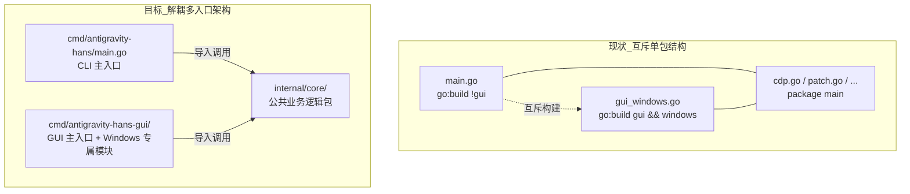

# Plan: 解耦 CLI 与 GUI 入口架构（消除 Build Tag 互斥与 gopls 告警）

**问题陈述**：
当前仓库根目录下的 `main.go` 与 `gui_windows.go`（及相关 GUI 源码）同属 `package main`，通过 `//go:build !gui` 与 `//go:build gui && windows` 实现互斥编译。这导致 Go 语言服务器 `gopls` 在默认上下文或单一 build tag 模式下无法同时识别双端入口，必然在一侧抛出 `No packages found for open file ... This file may be excluded due to its build tags`，并对多入口代码导航、重构及静态分析造成割裂。需将入口彻底解耦，消除条件编译互斥依赖。

**需求**：
1. 消除根目录入口互斥的 `//go:build !gui` 和 `//go:build gui` 约束，使编辑器（VS Code / Zed）无需任何额外 `buildFlags` 即可同时对 CLI 和 GUI 提供完整的语法补全、跳转与诊断。
2. 保持对外行为与现有发布流程完全一致：CLI 控制台版本与 GUI 托盘版本的编译输出、参数与功能无任何破坏性变更。
3. 严格遵循 Go 官方标准项目布局（Standard Go Project Layout），清晰划分公共逻辑与应用入口。
4. 当前阶段用户已通过 `.vscode/settings.json` 临时配置保障日常开发，本计划落盘至 `plans/` 并由根目录 `TODO.md` 进行代办跟踪，待排期后执行。

**背景**：
- 现有结构中，所有业务逻辑（CDP、Launcher、Patch、Detect、Shortcut 等）均平铺在根目录的 `package main` 中。
- `main.go` 为控制台 CLI 主入口，声明了 `//go:build !gui`。
- `gui_windows.go`、`gui_autostart_windows.go`、`gui_singleinstance_windows.go`、`gui_tray_windows.go` 为 Windows GUI 主入口，声明了 `//go:build gui && windows`。
- `gui_other.go` 为非 Windows 环境构建 GUI 时的打桩报错文件，声明了 `//go:build gui && !windows`。
- `build.sh`、`scripts/build-gui.py` 与 `.github/workflows/release.yml` 均以根目录 `.` 作为构建入口。

**方案**：
采用 Go 社区标准的 `cmd/` + `internal/core/` 架构拆分：
1. 将根目录下所有的公共逻辑抽象为 `internal/core` 包（导出必要方法如 `PatchOnce`、`StartLauncher`、`DetectLanguage` 等）。
2. 在 `cmd/antigravity-hans/` 下维护独立 CLI 入口，移除 `//go:build !gui` 标签。
3. 在 `cmd/antigravity-hans-gui/` 下维护独立 GUI 入口及 Windows 专属模块，移除 `gui` 编译标签（保留 `windows` / `!windows` 平台系统标签）。
4. 更新 `build.sh`、`scripts/build-gui.py` 与 CI 工作流，将编译路径指向对应的 `cmd/*` 目录。

**任务分解**：

- [ ] Task 1: 创建 internal/core 共享核心包并迁移公共模块
  - 文件：`internal/core/cdp.go`、`internal/core/cdp_test.go`、`internal/core/config.go`、`internal/core/detect.go`、`internal/core/langcheck.go`、`internal/core/launcher.go`、`internal/core/overlay.go`、`internal/core/patch.go`、`internal/core/registry_windows.go`、`internal/core/registry_other.go`、`internal/core/shortcut_windows.go`、`internal/core/shortcut_darwin.go`、`internal/core/shortcut_other.go`、`internal/core/sysproc_windows.go`、`internal/core/sysproc_unix.go`、`internal/core/antigravity-hans-overlay.js`
  - 实现：新建 `internal/core` 目录并将上述公共文件迁入；将包名改为 `package core`；导出 CLI 与 GUI 所需的公共接口与配置结构体（如 `RunMode`、`StartLauncher`、`PatchOnce` 等）。
  - 验证：执行 `go test -v ./internal/core/...`，预期全部单元测试通过。
  - Demo：核心业务逻辑可作为独立包被单元测试驱动并成功编译。

- [ ] Task 2: 抽取 CLI 入口至 cmd/antigravity-hans
  - 文件：`cmd/antigravity-hans/main.go`、`main.go`（移除）
  - 实现：新建 `cmd/antigravity-hans` 目录并迁入原 `main.go`；彻底删除头部的 `//go:build !gui`；导入并使用 `antigravity-hans/internal/core`；移除根目录已迁出的 `main.go`。
  - 验证：执行 `go build -o dist/test-cli.exe ./cmd/antigravity-hans`，预期编译成功且无报错。
  - Demo：运行 `dist/test-cli.exe` 可正常输出 Banner 与控制台交互主菜单。

- [ ] Task 3: 抽取 GUI 入口至 cmd/antigravity-hans-gui
  - 文件：`cmd/antigravity-hans-gui/main.go`（原 gui_windows.go 改名/迁入）、`cmd/antigravity-hans-gui/autostart_windows.go`、`cmd/antigravity-hans-gui/singleinstance_windows.go`、`cmd/antigravity-hans-gui/tray_windows.go`、`cmd/antigravity-hans-gui/stub_other.go`、`cmd/antigravity-hans-gui/assets/appicon.png`、`rsrc_windows_amd64.syso`
  - 实现：新建 `cmd/antigravity-hans-gui` 目录并迁入所有 GUI 源码与内嵌资源；移除所有文件上的 `gui` tag，仅保留平台维度的 `windows` 与 `!windows`；导入并调用 `internal/core`；同步移除根目录下对应的 `gui_*.go` 文件。
  - 验证：执行 `go build -ldflags "-H windowsgui" -o dist/test-gui.exe ./cmd/antigravity-hans-gui`，预期成功生成 Windows 窗口程序。
  - Demo：双击运行 `dist/test-gui.exe`，托盘图标正常载入且不闪现黑框命令行。

- [ ] Task 4: 更新编译脚本与 CI/CD 发布流水线
  - 文件：`build.sh`、`scripts/build-gui.py`、`.github/workflows/release.yml`
  - 实现：更新 `build.sh` 中的编译目标路径为 `./cmd/antigravity-hans`；更新 `scripts/build-gui.py` 的目标为 `./cmd/antigravity-hans-gui` 并移除 `-tags gui` 参数；更新 GitHub Actions 的三端编译指令。
  - 验证：分别在本地测试执行 `python scripts/build-gui.py --dev` 与 `./build.sh`，预期产物与路径完整生成。
  - Demo：一键编译流水线能同时无误产出 release / dev 规格的 CLI 与 GUI 可执行文件。

- [ ] Task 5: 清理临时 LSP 配置与接线收尾
  - 文件：`.vscode/settings.json`、`README.md`
  - 实现：清理 `.vscode/settings.json` 中的 `buildFlags: ["-tags=gui"]` 临时垫片；验证在未配置任何 build tags 情况下，VS Code 与 Zed 同时打开 `cmd/antigravity-hans/main.go` 与 `cmd/antigravity-hans-gui/main.go` 均能正常补全跳转且 0 警告；更新 `README.md` 中的源码目录说明。
  - 验证：检查编辑器问题列表（Problems），预期无任何 `No packages found for open file` 告警。
  - Demo：实现跨平台 CLI 与 Windows GUI 源码在现代 IDE 中的开箱即用零告警体验。

---
**最后更新：** 2026-10-06  
**作者：** AI & User  
**状态：** 待排期（当前采用 `.vscode/settings.json` 临时方案，详见 `TODO.md`）
